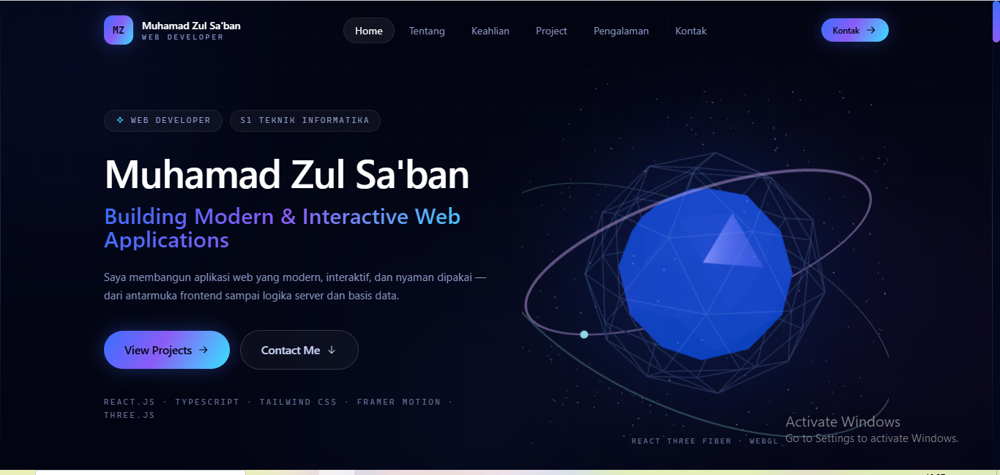

# Portofolio Developer 3D

Template website portofolio developer modern dengan tampilan 3D interaktif. Dibangun menggunakan React, TypeScript, Tailwind CSS, Framer Motion, dan React Three Fiber.

Proyek ini dibuat agar siapa saja dapat memiliki website portofolio pribadi yang modern, menarik, dan responsif.

**Gratis digunakan, dimodifikasi, dan dikembangkan sesuai kebutuhan.**

## Tampilan Website



## Fitur Utama

- Tampilan modern dengan desain 3D interaktif.
- Animasi menggunakan Framer Motion.
- Hero 3D menggunakan React Three Fiber.
- Desain responsif untuk desktop dan perangkat mobile.
- Bagian About Me, Projects, Skills, Experience & Education, dan Contact.
- Navigasi dengan indikator section aktif.
- Efek glassmorphism dan gradient.
- Fallback visual apabila perangkat tidak mendukung WebGL.
- Mendukung preferensi reduced motion.
- Optimasi performa dengan lazy loading.
- SEO dan Open Graph.
- Form kontak menggunakan mailto.

## Teknologi yang Digunakan

| Teknologi | Kegunaan |
|---|---|
| React 19 | Library antarmuka pengguna |
| TypeScript 5.9 | Bahasa pemrograman |
| Vite 7 | Build tool dan development server |
| Tailwind CSS 3.4 | Styling |
| Framer Motion 12 | Animasi antarmuka |
| React Three Fiber 9 | Visualisasi 3D |
| Three.js | Rendering objek 3D |

## Persyaratan

Pastikan perangkat sudah memiliki:

- Node.js versi 20 atau lebih baru.
- npm.
- Git (opsional, untuk mengelola repository).

## Cara Instalasi

**1. Clone repository**

```bash
git clone https://github.com/USERNAME/portofolio-developer-3d.git
```

**2. Masuk ke direktori proyek**

```bash
cd portofolio-developer-3d
```

**3. Instal dependensi**

```bash
npm install
```

**4. Jalankan aplikasi**

```bash
npm run dev
```

Buka alamat berikut di browser:

```text
http://localhost:5173
```

## Perintah yang Tersedia

| Perintah | Keterangan |
|---|---|
| `npm run dev` | Menjalankan development server |
| `npm run build` | Memeriksa TypeScript dan build produksi |
| `npm run preview` | Menampilkan hasil build |
| `npm run typecheck` | Memeriksa tipe TypeScript |

## Kustomisasi

Kamu dapat mengganti konten website tanpa harus mengubah seluruh komponen.

| File | Kegunaan |
|---|---|
| `src/data/profile.ts` | Nama, deskripsi, kontak, dan media sosial |
| `src/data/projects.ts` | Daftar proyek portofolio |
| `src/data/skills.ts` | Daftar keahlian |
| `src/data/timeline.ts` | Riwayat pendidikan dan pengalaman |
| `src/data/navigation.ts` | Menu navigasi |
| `index.html` | Judul dan metadata SEO |
| `src/components/three/HeroObjects.tsx` | Objek visual 3D |

**Catatan:** Ganti seluruh data placeholder dengan informasi milik sendiri sebelum website dipublikasikan.

## Build Produksi

Untuk membuat versi produksi, jalankan:

```bash
npm run build
```

Hasil build akan tersimpan di direktori:

```text
dist/
```

Folder tersebut dapat diunggah ke layanan hosting statis seperti:

- Vercel
- Netlify
- GitHub Pages
- cPanel
- VPS dengan Nginx

## Lisensi

Proyek ini menggunakan **MIT License**.

Kamu bebas menggunakan, mempelajari, memodifikasi, dan mengembangkan proyek ini sesuai kebutuhan dengan tetap menyertakan pemberitahuan lisensi.

## Dukungan

Jika proyek ini bermanfaat, jangan lupa memberikan ⭐ Star pada repository ini.

Silakan gunakan dan kembangkan sesuai kreativitas masing-masing.

**Selamat berkarya dan semoga bermanfaat untuk komunitas developer Indonesia!**